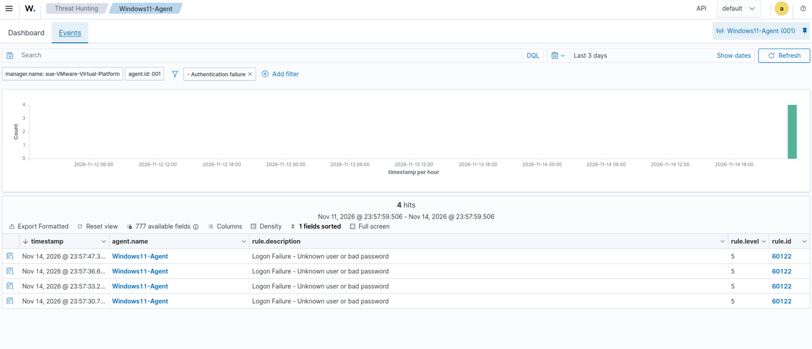
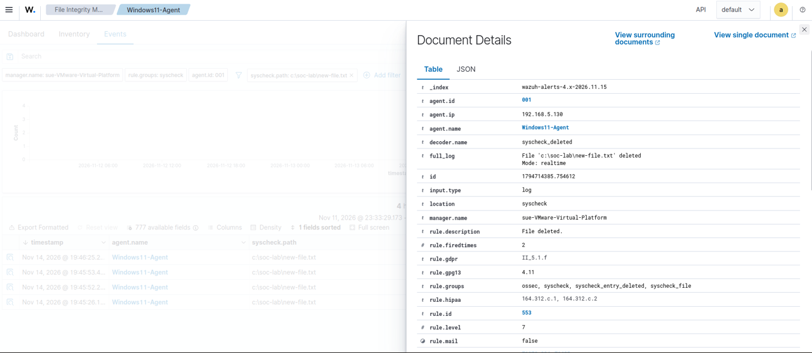
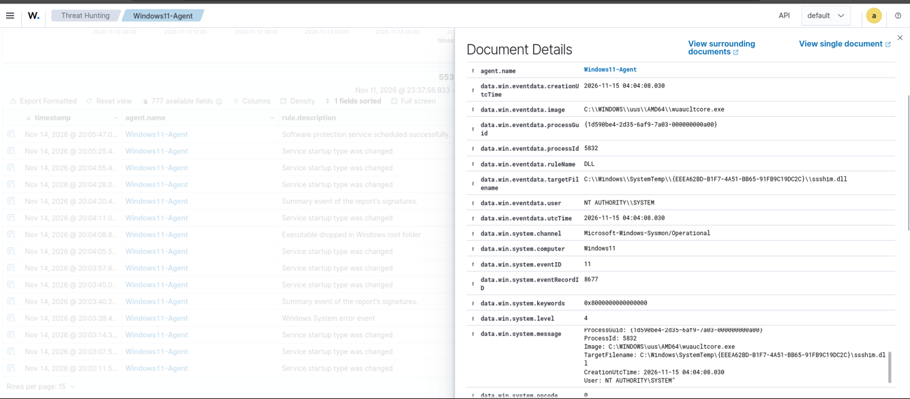

# Home SOC Lab – SIEM Monitoring & Threat Detection

## Project Overview

This project is a hands-on Security Operations Center (SOC) lab built using Wazuh, Ubuntu Server, and Windows 11 virtual machines.

The goal was to create a security monitoring environment where I could collect endpoint logs, detect suspicious activity, and investigate security events.

## Lab Environment

| Component | Purpose |
|---|---|
| Ubuntu Server | Wazuh Manager |
| Windows 11 | Monitored endpoint |
| Wazuh Agent | Collects and forwards endpoint logs |
| Wazuh Dashboard | Security monitoring and investigation |
| Sysmon | Windows system activity monitoring |
| VMware | Virtual machine environment |

## Project Implementation

### 1. SIEM Deployment and Configuration

- Installed and configured Wazuh Manager on Ubuntu.
- Deployed the Wazuh agent on a Windows 11 virtual machine.
- Connected the Windows endpoint to the Wazuh manager.
- Verified agent connectivity and log collection.

### 2. Windows Authentication Monitoring

- Monitored Windows authentication events through Wazuh.
- Generated failed login attempts to test security monitoring.
- Used Wazuh Threat Hunting to locate and review authentication failures.
- Examined event details to understand potential unauthorized login activity.

**Evidence:**

### 3. File Integrity Monitoring (FIM)

- Configured Wazuh to monitor a designated Windows directory.
- Enabled real-time monitoring and file change reporting.
- Tested file creation, modification, and deletion.
- Reviewed file hashes and content differences in the Wazuh dashboard.

**Evidence:**

### 4. Sysmon Monitoring

- Installed Sysmon on the Windows endpoint.
- Configured the Wazuh agent to collect Sysmon operational logs.
- Reviewed Sysmon events through Wazuh Threat Hunting.
- Examined event details, executable paths, and file activity.

**Evidence:**

## Skills Demonstrated

- SIEM Configuration and Monitoring
- Wazuh
- Windows Event Log Analysis
- File Integrity Monitoring
- Endpoint Monitoring
- Sysmon
- Authentication Event Analysis
- Linux and Windows Administration
- Virtual Machine Configuration
- Security Event Investigation

## Conclusion

This project provided hands-on experience configuring a SIEM environment and monitoring Windows endpoint activity. It helped me understand how security monitoring tools collect logs, identify changes, and support the investigation of potentially suspicious events.
